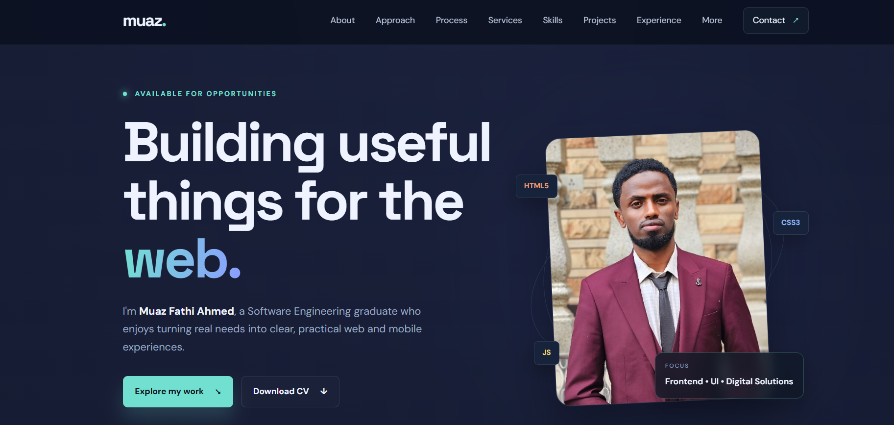
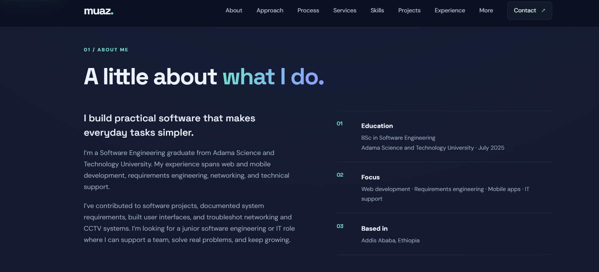
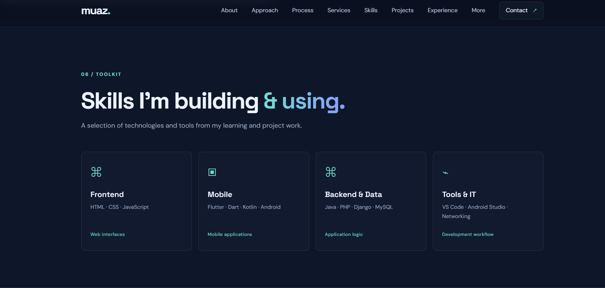
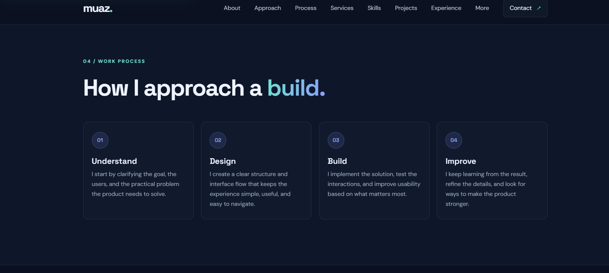
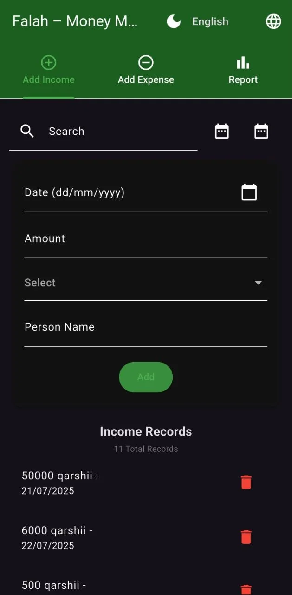
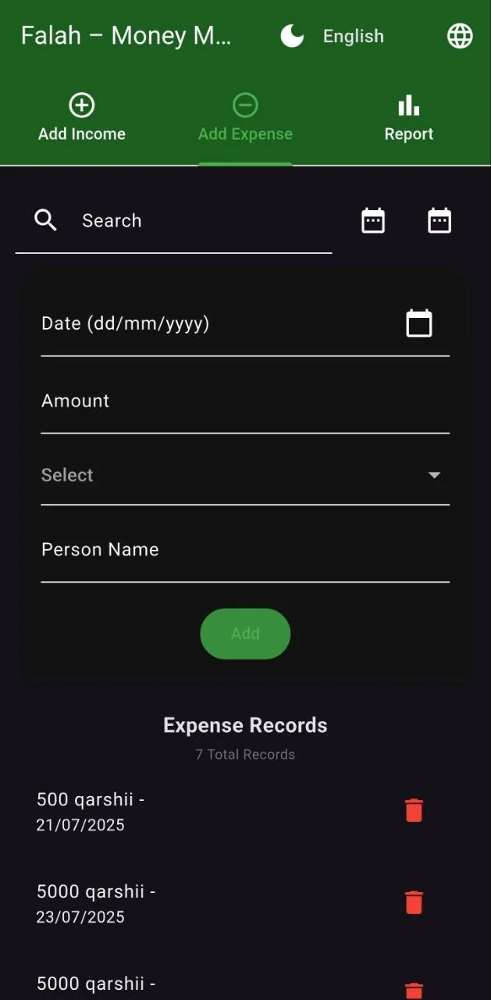
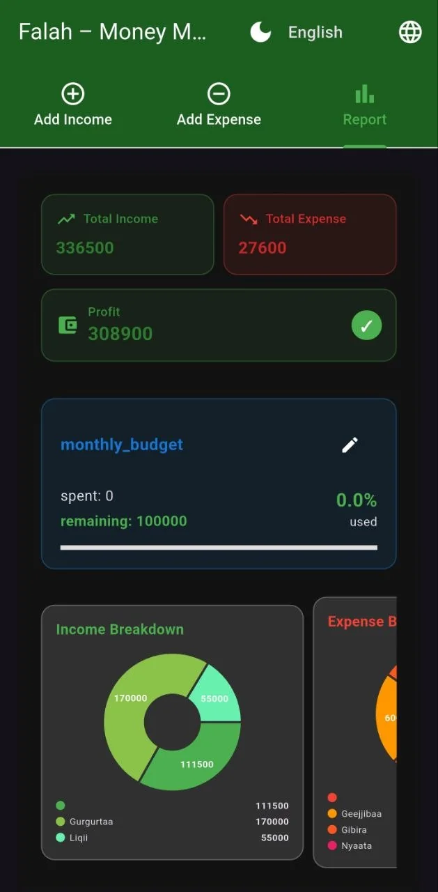

# Muaz Fathi Ahmed — Portfolio

Responsive portfolio website built with HTML, CSS, and vanilla JavaScript.

## Portfolio screenshots

| Home | About |
| --- | --- |
|  |  |

| Skills | Work process |
| --- | --- |
|  |  |

## Project screenshots

Screenshots from the Falah money management app featured in the portfolio:

| Add income | Add expenses | Financial report |
| --- | --- | --- |
|  |  |  |

## Run locally

From this directory, start a local static web server:

```sh
python3 -m http.server 8000
```

Then open http://localhost:8000 in a browser. Alternatively, open `index.html` with the VS Code Live Server extension.

## Structure

```text
muaz-portfolio/
├── index.html
├── style.css
├── script.js
├── README.md
└── assets/
    ├── image-1.png
    ├── image-2.png
    ├── image-3.png
    ├── image-4.png
    ├── Muaz-Fathi-Ahmed-CV.pdf
    ├── muaz.jpg
    └── falah/
        ├── falah-income.webp
        ├── falah-expense.webp
        └── falah-report.webp
```
